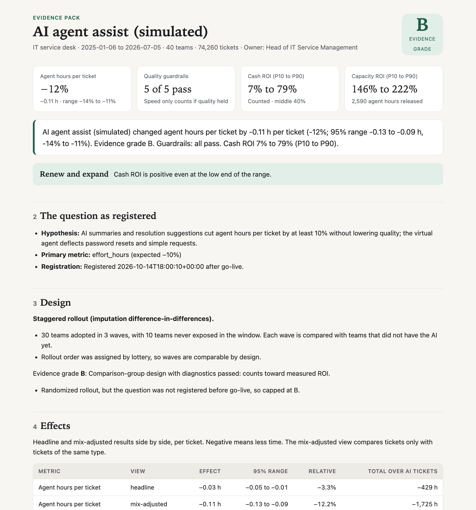

# Probative Labs

**Independent proof of what enterprise AI delivers.** AI vendors report their own value, usually as usage multiplied by an assumed time saving. Probative Labs checks it, independently and reproducibly:

- **Plan:** design the rollout so the effect can be proven, and lock the question before go-live.
- **Verify:** measure what actually changed against teams that did not have the AI yet, and audit the resolutions an AI claims, including the ones you pay for.
- **Benchmark:** compare with other companies running the same AI, without sharing data.

This repository is the open-source engine. The method is published and validated against planted truths, and every result can be rerun by your own data team or auditor. v0.2 covers the IT service desk.

**[Website](https://vivekreddygaddam.github.io/probative-labs/)** · **[Sample evidence pack](https://vivekreddygaddam.github.io/probative-labs/sample/evidence-pack.html)** · **[Sample resolution audit](https://vivekreddygaddam.github.io/probative-labs/sample/resolution-audit.html)** · **[Run a pilot on your own data](docs/pilot-guide.md)**

```
$ probative demo
AI agent assist (simulated) changed agent hours per ticket by -0.11 h per ticket (-12%; 95% range -0.13
to -0.09 h, -13% to -10%). Evidence grade B. Guardrails: all pass. Cash ROI 5% to 77% (P10 to P90).

Of 3,543 resolutions the AI claimed, an estimated 12% (95% range 11% to 13%) did not hold: the person
came back within 7 days, beyond the normal return rate after human-resolved tickets of the same types.
At $1.00 per resolution, about $435 ($400 to $477) was paid for resolutions that did not hold.

Planted truth: -0.111 h per ticket; 12.2% of the virtual agent's resolutions came back.
```

## Why independent

Most AI ROI figures come from the vendor whose product is being judged. Built-in value dashboards typically multiply how often the AI was used by a time saving someone assumed. Careful studies show the same kind of tool can be strongly positive, zero or negative, and people cannot tell which by feel: in [METR's randomized trial](https://arxiv.org/abs/2507.09089), experienced developers took 19% longer with AI while believing they were 20% faster.

AI is also moving to outcome pricing: agents billed per resolution or per conversation. When you pay per outcome, someone other than the seller should check that the outcomes happened. Probative Labs sells no AI and takes no money from AI vendors; see [INDEPENDENCE.md](INDEPENDENCE.md).

## Quickstart

Python 3.12 or newer.

```bash
pip install probative-labs          # or: uv tool install probative-labs
probative demo --open
```

`probative demo` simulates a 40-team service desk with a known AI effect and a known share of false virtual-agent resolutions. The data has deflection, seasonality, a staggered rollout and messy records. The demo measures it end to end and writes an evidence pack and a resolution audit, so you can check both against the truth.

## Three ways to use it

### Audit the resolutions an AI claims

Works for any desk with a virtual agent or AI agent, **including desks where everyone got the AI on the same day.**

```bash
probative audit --tickets incidents.csv --preset servicenow --claims virtual_agent.csv --price 0.99
```

A claimed resolution holds if the person does not open a ticket about the same type of issue within 7 days. Some people come back after any resolution, so the return rate after the AI is compared with the return rate after human-resolved tickets of the same types in the same months. The excess is the share of claims that did not hold, with a range, a confidence level and, if you give a price, what was paid for them. See [docs/resolution-audit.md](docs/resolution-audit.md).

### Measure what changed

Needs teams that got the AI on different dates, or some teams held back.

```bash
probative init --preset servicenow   # writes probative.yaml; see `probative presets`
probative health                     # data quality and field mapping report
probative analyze --open             # evidence pack: HTML, Markdown and JSON
```

You need a ticket export (ServiceNow, Jira Service Management, Zendesk, Freshservice, BMC Helix and Ivanti work as-is) and a rollout file saying which team got the AI on which date. See [docs/data-model.md](docs/data-model.md) and [docs/configuration.md](docs/configuration.md).

### Plan before go-live

The cheapest time to make evidence strong is before the rollout.

```bash
probative plan waves teams.csv --waves 3 --start 2026-11-02 --holdout 0.2   # lottery-based wave order
probative register                   # lock hypothesis, metrics and guardrails before results exist
probative plan pack --open           # the measurement plan to sign: waves, power, guardrails, decision rules
```

A randomized wave order registered before go-live earns evidence grade A.

### Contribute to the benchmark

```bash
probative benchmark --results out/results.json --audit out/audit/audit.json
```

Writes an anonymous summary (rates, ranges, grades and size bands; no names, ticket text or money) for you to review and, if you choose, share. Once enough companies contribute for the same AI product, contributors see how theirs compares. See [docs/benchmarks.md](docs/benchmarks.md).

## What you get



- **Evidence pack** ([sample](https://vivekreddygaddam.github.io/probative-labs/sample/evidence-pack.html), [Markdown](docs/sample/evidence-pack.md)): the effect and its range, the design and why, headline versus mix-adjusted results, an event-study chart, quality guardrails, diagnostics, capacity and cash ROI ranges, the vendor's claim beside the measured result, assumptions with owners, data lineage and a renew, expand, fix or stop recommendation.
- **Resolution audit** ([sample](https://vivekreddygaddam.github.io/probative-labs/sample/resolution-audit.html)): claimed resolutions that did not hold, by issue type and month, with robustness checks, coverage and the amount paid for failed resolutions.
- **Measurement plan:** the rollout, its power to detect the expected effect, guardrails, decision rules agreed in advance, the registration hash and a sign-off table.

## The method, briefly

- **Compare like with like.** Every ticket is typed. When AI absorbs the easy tickets, the average human ticket gets harder and headline resolution time rises even if every type got faster. The mix-adjusted effect is reported beside the headline.
- **Compare against the right group.** Staggered rollouts are estimated with the imputation estimator (Borusyak, Jaravel and Spiess, 2024). Each AI team-week is compared only with data that had no AI.
- **Teams, not tickets, are the unit of uncertainty.** Ranges come from resampling whole teams, widened by a small-sample correction and a delete-one-team jackknife. Audit ranges come from resampling people, widened by a leave-one-month-out jackknife.
- **Check before you believe.** Pre-trend test, placebo rollout dates and placebo outcomes share a 5% family-wise error budget. Any failure drops the result to grade D: shown, never added to totals.
- **No design, no number.** If everyone got the AI on the same day and nobody was held back, the effect estimate says so instead of producing a figure. The resolution audit still works.

Full method: [docs/methodology.md](docs/methodology.md). Evidence grades: [docs/evidence-grades.md](docs/evidence-grades.md). Validation on planted truths, including zero: [docs/validation.md](docs/validation.md).

## Privacy by design

- Person and record identifiers are replaced with keyed HMAC-SHA256 pseudonyms at ingest.
- Free text is used only to type work, then dropped.
- Results are team-level only, and teams below a minimum group size are left out. Probative Labs evaluates AI programs, never people.
- Everything runs locally. No data leaves your machine, and benchmark contributions are never sent automatically.

## Open source and Probative Labs Cloud

The method and this engine are open source under Apache-2.0. Probative Labs Cloud runs the same engine for a whole AI portfolio: live read-only connectors, resolution audits on fresh data, peer benchmarks, the cost ledger, single sign-on and audit logs. See [OPEN_CORE.md](OPEN_CORE.md) for what is where and why.

## Status and roadmap

v0.2 is alpha. It covers the IT service desk. Planned next:

- Agent-level staggered adoption, for desks where every team got the AI at once but people started using it at different times
- Synthetic control and interrupted time series
- Ready-made mappings for conversation and automated-resolution exports
- Software engineering, customer service, security and finance playbooks

Breaking changes are possible before 1.0.

## Contributing

Issues and pull requests are welcome. Method changes must come with validation on simulated data; see [CONTRIBUTING.md](CONTRIBUTING.md). To report a security issue, see [SECURITY.md](SECURITY.md).

## License

Apache License 2.0. See [LICENSE](LICENSE) and [NOTICE](NOTICE). "Probative Labs" is a trademark of its author; the license does not grant rights to the name.
